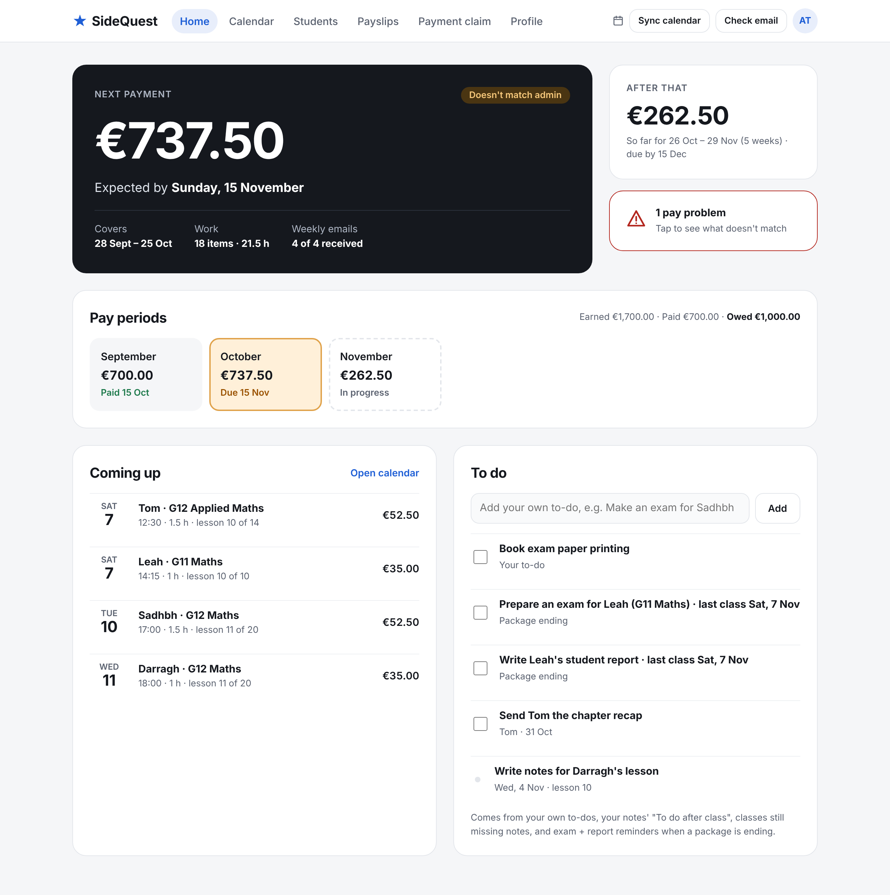
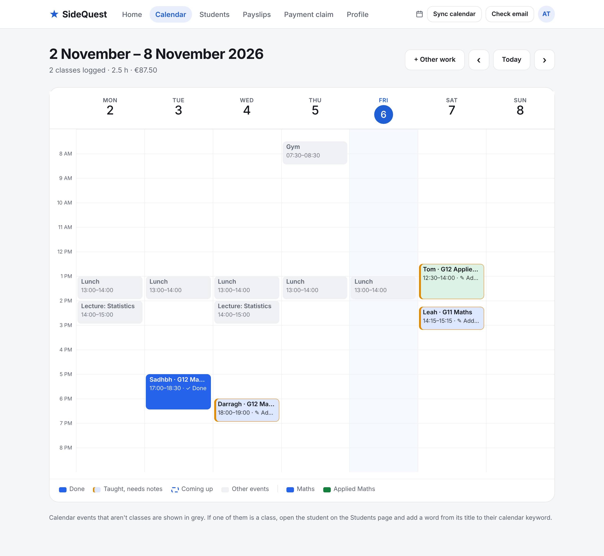
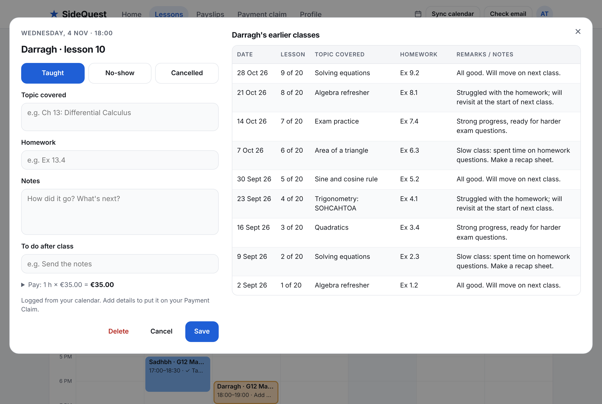
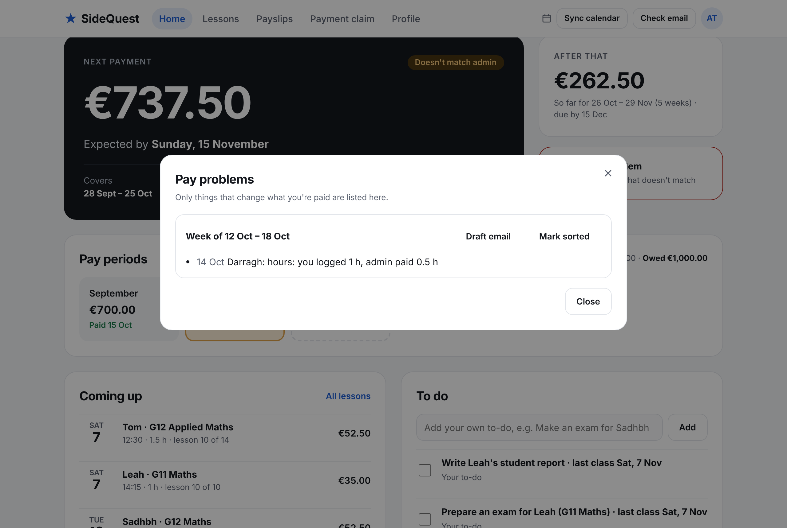
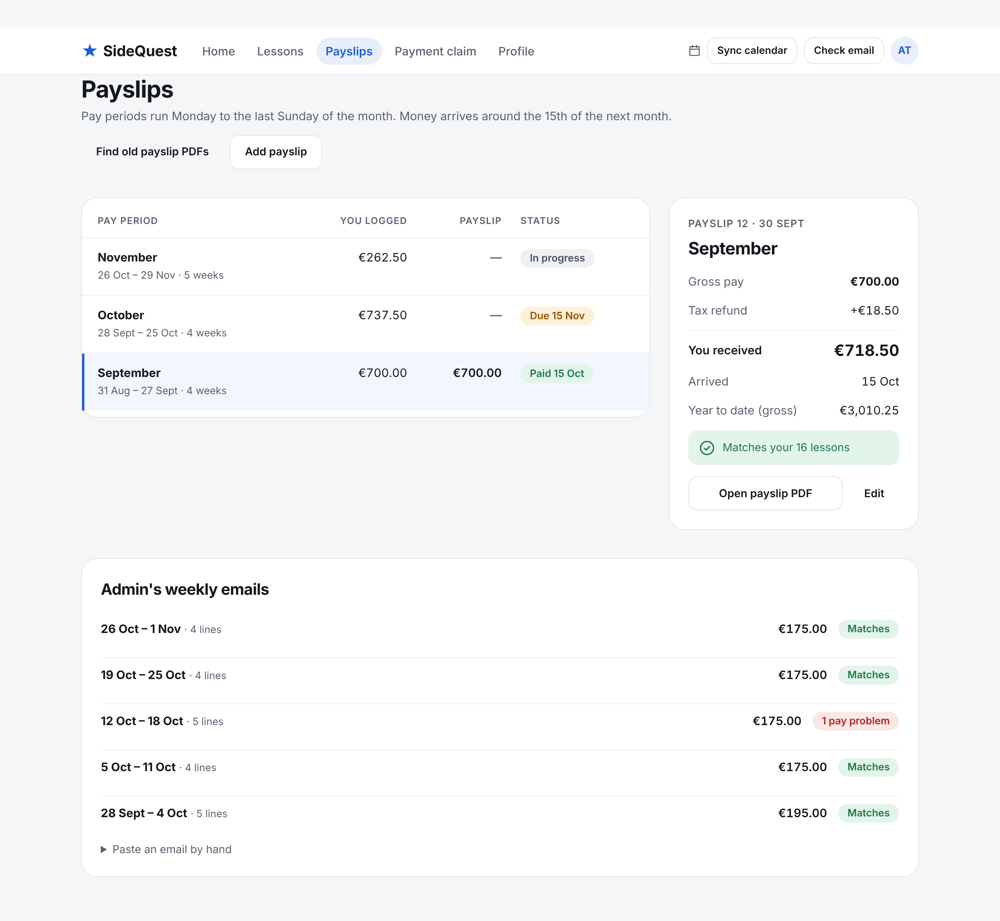
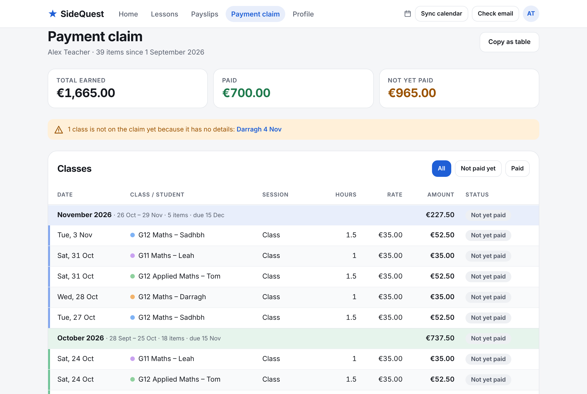
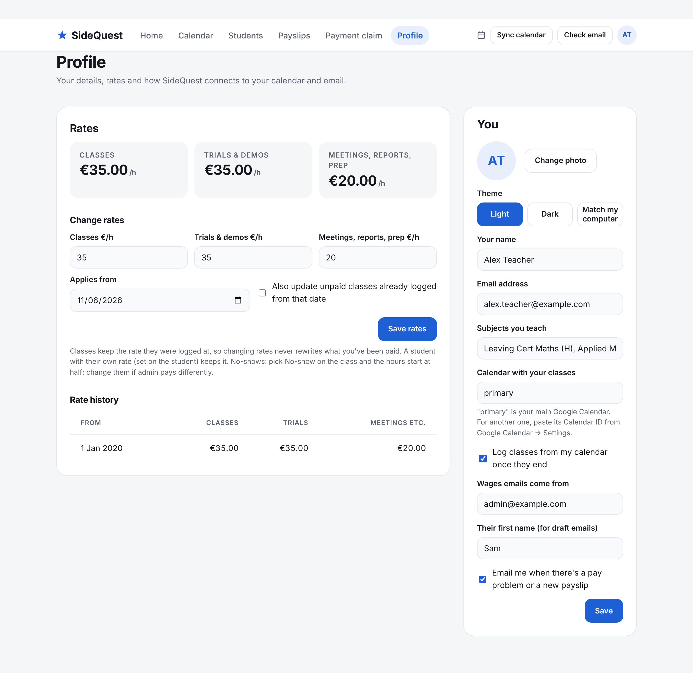
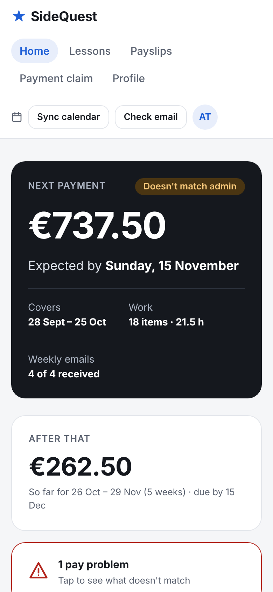
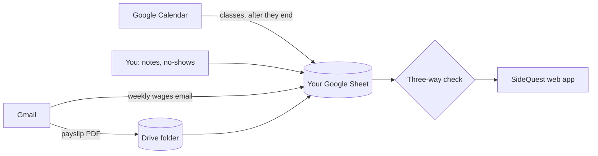

# ⭐ SideQuest

**Keep your tutoring side gig on track.** SideQuest logs every class you teach, reads your agency's weekly wages emails and monthly payslips, and checks all three against each other, so you know what you're owed, when it's coming, and whether anything's missing.

It runs free on your own Google account (a Google Sheet plus a small Apps Script web app). Your data never leaves your Google Drive.



---

## Why it exists

If you tutor through an agency, your pay usually comes from three places that don't talk to each other:

Mistakes slip in: a class left off a weekly email, half an hour paid instead of an hour, a payslip that doesn't add up. Catching them by hand means a spreadsheet you fill in after every class. SideQuest does that checking for you.

## What it does for you

- **Logs your classes from Google Calendar.** Any event whose title has a student's name or course code becomes a class. Once it has ended, it's logged automatically: no typing.
- **Knows trials and meetings too.** Events with *trial*, *demo*, *meeting*, *parent* or *report* in the title are planned and logged as that kind of work (at the right rate), never as a package class. A trial that goes well becomes a new student in one click.
- **Reads the weekly wages email** every Monday and Tuesday morning and matches each line to a class you taught. Only things that change your pay are flagged (wrong hours, wrong rate, a class left off), not cosmetic glitches in the email.
- **Reads payslip PDFs** straight from your inbox, saves them to Drive, and checks the gross against your classes. It works even when Google's PDF conversion scrambles the columns (it finds gross and net by checking they add up).
- **Knows the pay calendar.** Pay periods run Monday to the last Sunday of each month (4 or 5 weeks) and money arrives around the 15th of the next month. If a payslip states different dates, those win.
- **Drafts the email to admin** when something doesn't match. You copy it; nothing is sent for you.
- **Keeps your teaching notes** (topic, homework, remarks) with each student's full history beside you while you write.
- **Keeps your to-dos**, including the ones you've ticked off, so you can look back at what you finished and when.
- **Builds your payment claim**: every class, its status (paid, payslip in, not yet paid) and which payment it belongs to, ready to copy into Excel or an email.
- **Reminds you when a package ends**: a week before a student's last booked class, you get "Prepare an exam" and "Write the student report" to-dos.

## A tour

| | |
|---|---|
|  | **Calendar.** Your week, laid out like Google Calendar. Each subject has its own colour; solid means done, an amber edge means it needs notes, a dashed outline means it's coming up. Lunch, lectures and everything else stay grey. |
|  | **Class notes.** Mark a class taught, a no-show (half pay to start, editable) or cancelled, and write notes with the student's earlier classes on the right. Future classes just show when they start. |
|  | **Pay problems.** Only differences that affect your money. Each week has a ready-made email to admin. |
|  | **Payslips.** Each pay period with what you logged, what the payslip says, tax refund, net and when it arrived. Open the PDF in one click. |
|  | **Payment claim.** Your full claim with frozen headers, a colour band per pay period and a dot per student. A class appears once you've added its notes. |
|  | **Profile.** Your rates and the date each starts (old classes keep their old rate), photo, light or dark theme, and where your wages emails come from. |



*All screenshots use invented students and amounts.*

## How it works



Everything is stored as plain tabs in a Google Sheet you own: Students, Lessons, Statements, Payslips, Todos, Settings. You can open, edit, export or back it up like any spreadsheet.

**The three-way check.** Each line on a weekly email is matched to a logged class by course code and date (falling back to the student's name). Each payslip's gross is compared with the classes in its pay period and with that period's weekly emails. Only differences in hours, rate or amount count as problems.

## Install (about 10 minutes, no coding)

**👉 [Step-by-step install guide](docs/INSTALL.md)**

In short: download 3 files, paste them into a new Google Sheet's Apps Script editor, press *Run*, and publish it as a private web app. The guide shows exactly where to click and what you should see after each step.

The weekly-email reader expects GoMappEd-style wages emails (`Number · Lesson Name · Course Name · … · Subtotal · Teacher`, ending in a `Total` line), and the payslip reader is tuned to Sage Payroll payslips. Other formats need small changes in `src/shared/logic.js`.

### Bringing in your history

If you've been tracking classes elsewhere, put them in a `History.js` file in a `private/` folder. It is git-ignored and never goes on GitHub. The build adds it to `dist/`; then run **SideQuest → Import history** once. (This is for developers building from source.)

```js
const HISTORY_LESSONS = [
  { id: "h-2026-09-02-sadhbh-1", date: "2026-09-02", time: "17:00", studentId: "sadhbh", kind: "class",
    hours: 1.5, rate: 35, number: 1, topic: "Functions", homework: "Ex 1.2", notes: "Strong start", source: "history" },
];
const HISTORY_PAYSLIPS = [ { id: "slip-sep", periodStart: "2026-08-31", periodEnd: "2026-09-27", gross: 892.5, receivedDate: "2026-10-15" } ];
```

Older payslip PDFs are found with **Payslips → Find old payslip PDFs**, which searches all your past wages emails.

## Privacy

- Your data lives in **your** Google Sheet and Drive. SideQuest has no server, no database and no analytics.
- The web app is deployed as *Only myself*, so nobody else can open it, even with the link.
- Student information about minors should stay private: don't share the Sheet, and keep `private/` out of version control (it's in `.gitignore`).

## Development

```bash
npm run build         # src/ → dist/ (for clasp) and release/ (the 3 files in each GitHub Release)
npm test              # runs the Apps Script code in Node against fake Google services (both dist/ and the single Code.gs)
npm run screenshots   # regenerates docs/screenshots with invented demo data (needs Playwright)
```

```
src/server/Code.js    Apps Script: Sheet storage, Gmail, Calendar, Drive, triggers, web API
src/shared/logic.js   Parsing and checking, shared by server and page (weekly emails, payslips, pay periods)
src/web/              The web page: shell.html (layout and styles) + app.js
test/                 server.test.js, invented demo data and fixtures
scripts/              build, screenshots
```

### Design notes

- **Matching records without a shared ID.** Weekly email lines and calendar events don't carry your lesson IDs, so SideQuest links them on course code + date, falling back to name + date. This is the classic record-linkage problem; the deterministic version is enough here because date and student are nearly unique (Fellegi & Sunter, 1969).
- **Your data, your files.** Storage is a Sheet in the user's own Drive rather than a hosted database, following the local-first idea that people should own their data and be able to use it without the app (Kleppmann et al., 2019).
- **Reading scrambled PDFs.** Google's PDF-to-text conversion doesn't keep column order, so the payslip reader looks for numbers where gross − deductions = net and cross-checks with the expected pay, instead of relying on layout.

**References**
- Fellegi, I. P., & Sunter, A. B. (1969). A theory for record linkage. *Journal of the American Statistical Association*, 64(328), 1183–1210.
- Kleppmann, M., Wiggins, A., van Hardenberg, P., & McGranaghan, M. (2019). Local-first software: You own your data, in spite of the cloud. *Proceedings of Onward! 2019*, ACM.

## Licence

MIT. See [LICENSE](LICENSE).
