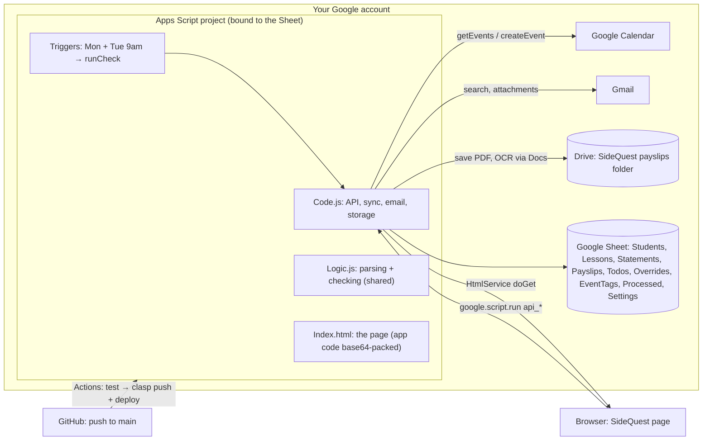

# SideQuest: technical documentation

*For understanding, changing and debugging SideQuest. Written against the code on `main` as of 27 Nov 2026.*

Contents
1. [What it is, in one paragraph](#1-what-it-is-in-one-paragraph)
2. [Architecture](#2-architecture)
3. [Repository layout](#3-repository-layout)
4. [Build and deploy](#4-build-and-deploy)
5. [Data model (every tab, every column)](#5-data-model)
6. [How the main flows work](#6-how-the-main-flows-work)
7. [The web page (client)](#7-the-web-page-client)
8. [Function reference](#8-function-reference)
9. [Tests](#9-tests)
10. [Security and privacy](#10-security-and-privacy)
11. [Known limits and gotchas](#11-known-limits-and-gotchas)
12. [How to make common changes](#12-how-to-make-common-changes)

---

## 1. What it is, in one paragraph

SideQuest is a Google Apps Script web app bound to a Google Sheet. The Sheet is the database: one tab per record type. The server code (`Code.js`) reads Google Calendar to log classes, reads Gmail for the admin's weekly wages emails and Sage payslip PDFs, saves PDFs to Drive, and exposes a small API (`api_*` functions). The page (`app.js` + `shell.html`) is a single-page app served by HtmlService; it calls the API with `google.script.run`, keeps all data in memory, and does most of the pay arithmetic itself. A shared library (`logic.js`) holds the parsing and checking rules and runs both on the server and in the page. There is no other server, no database and no third-party service.

## 2. Architecture

Key properties:
- **Runs as you, only for you.** The web app is deployed `executeAs: USER_DEPLOYING`, `access: MYSELF` (see `src/appsscript.json`). Nobody else can open it, even with the link.
- **The Sheet is the source of truth for your records; Google Calendar is the source of truth for what is planned.** SideQuest never plans anything outside the calendar (*+ Add to calendar* creates a real calendar event).
- **Everything is recomputed on open.** Opening the page calls `api_getAll`, which first syncs the calendar, then returns every tab. Pay periods, problems, packages and the claim are computed in the browser from that snapshot.

## 3. Repository layout

| Path | What's in it |
|---|---|
| `src/server/Code.js` | Apps Script server: storage helpers, Sheet setup, calendar sync, email check, payslip reading, the `api_*` functions the page calls, triggers. |
| `src/shared/logic.js` | `L`: pure functions shared by server and page: weekly-email parser, internal checks, statement ↔ lessons matching, payslip parser, pay periods, problem list. No Google services. |
| `src/web/shell.html` | The page skeleton and all CSS (light + dark tokens), the error banner script, and the loader that unpacks the app code. |
| `src/web/app.js` | The page: state, views, dialogs, event handling. |
| `src/appsscript.json` | Apps Script manifest: time zone `Europe/Dublin`, V8, Drive advanced service v3, web-app settings. |
| `scripts/build.mjs` | Builds `dist/` (for clasp) and `release/` (3 files for manual installs). |
| `scripts/screenshots.js` | Regenerates README screenshots from demo data. |
| `test/server.test.js` | Server code against fake Google services (fixtures in `test/fixtures/`). |
| `test/calendar.test.js` | Calendar scenarios with a controllable clock and an editable fake calendar. |
| `test/money.test.js` | Weekly-email and payslip scenarios against `logic.js`. |
| `test/ui-fixture.js`, `test/ui-flows.js`, `test/ui-crawl.js` | Browser tests (Playwright) with a pretend server inside the page. |
| `test/demo.js` | Invented demo data (students, lessons, emails, calendar weeks) used by screenshots and UI tests. |
| `docs/INSTALL.md`, `docs/AUTO-DEPLOY.md` | User-facing install and auto-deploy guides. |
| `.github/workflows/deploy.yml` | CI: syntax check, build, tests, deploy, release. |
| `private/` (git-ignored) | Optional `History.js` with your past classes, merged into the build, never committed. |

## 4. Build and deploy

### Build (`scripts/build.mjs`)
- `dist/Logic.js` ← `src/shared/logic.js`
- `dist/Code.js` ← `src/server/Code.js` (+ `private/History.js` if present)
- `dist/Index.html` ← `shell.html` with `/*CODE*/` replaced by **base64 of `logic.js + app.js`**, in 76-character lines. At load, the loader script in `shell.html` decodes it (`atob` → `TextDecoder` UTF-8) and injects it as a `<script>` with `//# sourceURL=sidequest-app.js`.
  - *Why base64:* Google's HtmlService rewrites inline scripts on the way to the browser. That once turned the text "… in Google Calendar …" inside a template string into code ("Unexpected identifier 'Calendar'"). Base64 has nothing for it to rewrite.
- `dist/appsscript.json` ← `src/appsscript.json`
- `release/Code.gs` = `Code.js` + `logic.js` in one file; `release/Index.html`, `release/appsscript.json`. These are attached to the GitHub Release `latest` for people installing by hand (3 copy-pastes).

### CI (`.github/workflows/deploy.yml`)
On every push:
1. **test**: `node --check` on the three sources, build, `server.test.js`, `calendar.test.js`, `money.test.js`, then the server and calendar tests again against the single `release/Code.gs`.
2. **deploy** (main only, needs `test`): if the secrets `CLASPRC_JSON`, `SCRIPT_ID`, `DEPLOYMENT_ID` exist, writes `~/.clasprc.json` and `.clasp.json`, runs `clasp push --force` (replaces every file in the Apps Script project with `dist/`) and `clasp deploy --deploymentId …` (same URL, new version), then deletes the credentials file.
3. **release** (main only, needs `test`): deletes and recreates the `latest` release with the 3 files.

Forks and pull requests never receive the secrets, so they never deploy.

### First install (summary; full guide in `docs/INSTALL.md`)
Paste the 3 files into a Sheet's Apps Script project → run `setup` (creates tabs, default settings, Mon/Tue 9am triggers) → deploy as web app (Me / Only myself).

## 5. Data model

All tabs have a header row (row 1). Every column is formatted as plain text (`@`) so dates stay `yyyy-MM-dd` strings. Reading converts types by column name:
- **Numbers** (`NUM`): `weekday, hours, rate, pkgSize, priorCount, number, totalHours, totalAmount, gross, net, cumulativeGross, paye, usc, ownRate, amount` ("" → `null`).
- **Booleans** (`BOOL`): `active, followupsDone, resolved, needsCheck, mismatchOk, done` (stored `TRUE`/`FALSE`).
- **JSON** (`JSONF`): `lines`.
- Text that starts with `=` is stored with a leading `'` so it can never become a formula, and the `'` is removed when read.

New columns added in later versions are appended automatically the first time a row is written (`headWithNew_`). The `Overrides` and `EventTags` tabs are created on first use if missing.

### Students
| Column | Meaning |
|---|---|
| `id` | Stable id, e.g. `rory-maths`. |
| `name` | Display name. |
| `subject` | e.g. `G12 Maths (H)`. Used for colour, title matching tie-breaks and the claim. |
| `code` | Admin's course code (e.g. `IE1042`). Strongest link to calendar titles and email lines. |
| `weekday`, `time`, `hours`, `rate` | Usual slot (informational); `hours` is the default class length. |
| `pkgSize` | Lessons per package (e.g. 20). |
| `priorCount` | Lessons already taught before SideQuest (used when no numbered lesson exists). |
| `startDate`, `notes` | Informational. |
| `active` | `FALSE` = past student; not matched to calendar events. |
| `calKeyword` | Word(s) that must all appear in an event title (default: the name; add the subject for a student with two classes). |
| `ownRate` | Overrides the rate table for this student. |

### Lessons (classes and other work)
| Column | Meaning |
|---|---|
| `id` | `cal-xxxx` (from calendar), `h-…` (history import), `skip-…` (skipped), `l-…` (by hand). |
| `date`, `time` | `yyyy-MM-dd`, `HH:mm`. |
| `studentId` | Empty for work with no student (e.g. a trial before the student exists). |
| `label` | Title for non-class work (e.g. "Parent meeting – Ella"). |
| `kind` | `class` · `noshow` · `cancelled` · `demo` (trial) · `meeting` · `reports` · `prep` · `other`. |
| `hours`, `rate` | Pay = hours × rate (`cancelled` pays 0). |
| `number` | Lesson number within the package. **Only `class` uses up a lesson**; `noshow`/`cancelled`/work never carry a number. |
| `topic`, `homework`, `notes`, `followups`, `followupsDone`, `followupsDoneAt` | Your class notes. A lesson with any of `topic/notes/homework/followups` is "written up" and is never deleted automatically. |
| `updatedAt` | Last change (ISO). |
| `eventId` | Link to the calendar: `<eventId>@<date>` (one key per event per day; a repeating series shares the event id). `kept` = you chose to keep it although its event is gone. Older versions stored just `<eventId>`; still recognised. |
| `source` | `calendar` · `history` · `manual`. |

### Statements (admin's weekly wages emails)
`id` (= week start date), `weekStart`, `weekEnd`, `totalHours`, `totalAmount`, `lines` (JSON array of parsed lines: `row, label, code, pkgSize, counter, type, trial, date, time, duration, hours, rate, subtotal, teacher`), `raw` (email text, first 20,000 chars), `source`, `savedAt`, `resolved` (legacy "Mark sorted"; now shown as a handled override).

A later email for the same week replaces the earlier one.

### Payslips
`id`, `number` (legacy; the "57" on payslips is the employee number, never used), `payDate`, `periodStart`, `periodEnd`, `gross`, `net`, `cumulativeGross`, `paye`, `usc` (negative = refund), `receivedDate`, `pdfUrl`, `needsCheck` (amounts couldn't be read), `source` (`email`/`manual`), `mismatchOk` (legacy "It's fine"), `pdfText` (OCR text, first 20,000 chars).

### Todos
`id`, `text`, `done`, `createdAt`, `key` (for automatic ones, e.g. `exam-<student>-<packageStart>`; used to avoid duplicates), `doneAt`.

### Overrides (pay flags handled by hand)
`id`, `key`, `reason`, `amount`, `at`.
- `key` = `<groupKey>#<flagKey>`:
  - weekly email: `<statementId>#L:<number>|<date>|<time>|<code>` (a line), `#M:<lessonId>` (missing from admin's email), `#C:<text>` (internal check);
  - payslip: `slip-<payslipId>#gross`.
- `amount` (email lines only): what the line should count as in "admin agrees" (e.g. 0 for a cancelled line that was paid by mistake).

### EventTags (what a calendar event is, when you told SideQuest)
`id`, `series`, `title`, `tag`, `studentId`, `at`.
- `series` = the event id (covers all repeats), or `<eventId>@<date>` for one day only (written when you delete a calendar class in SideQuest, so it isn't logged again).
- `title` (optional) = applies to any event with exactly this title.
- `tag` = `student` (with `studentId`) · `demo` · `meeting` · `reports` · `ignore`.
- Lookup order (`tagFor_`): this day → this event/series → exact title.

### Processed
`messageId`, `date`, `subject`, `type` (`weekly`/`payslip`/`other`), `result`. Every Gmail message handled once; never re-read unless removed from here.

### Settings (key → value)
| Key | Meaning |
|---|---|
| `senders` | Addresses wages emails/payslips come from (comma separated). |
| `emailSummary` | `yes`/`no`: email yourself a summary when a check finds something. |
| `lookbackDays` | How far back each check searches Gmail. |
| `payslipFolder` | Drive folder for PDFs (default "SideQuest payslips"). |
| `calendarId` | `primary` or a calendar id. |
| `autoLog` | `yes`/`no`: log classes automatically once they end. |
| `calendarFrom` | Classes before this date are never logged from the calendar (history covers them). |
| `teacherName`, `adminName`, `email`, `subjects`, `photo`, `theme` | Profile. |
| `rateHistory` | JSON list `[{from, class, trial, other}]`; the latest `from ≤ date` applies. |
| `lastRun`, `oldSearch`, `oldSearchResult` | Status written by the app. |

## 6. How the main flows work

### 6.1 Opening the page
`doGet` → `Index.html` → loader decodes the app → `load()` calls `api_getAll` → server: `withLock_(syncCalendar_)` (errors don't block opening), dedupes todos, returns `{students, lessons, statements, overrides, eventtags, payslips, todos, profile, rates, status, calendar, today, now}`. The page stores it in `S` (records), `CAL` (calendar result), `PROFILE`, `RATES`, `STATUS`, then `render()`.

### 6.2 Calendar sync (`syncCalendar_`), step by step
Window: from the day before `calendarFrom` to 60 days ahead. Declined invitations are dropped (`declined_`).
1. **Live keys.** Collect `<eventId>@<date>` for every remaining event.
2. **Ghosts.** Lessons with an `eventId` whose key is no longer live (event deleted or moved) and dated in the window:
   - untouched ones (logged by SideQuest, no notes, not a no-show) are **deleted**, *before* anything new is logged so lesson numbers stay right;
   - **safety valve:** if more than 5 (or more than 20% of all lessons) would go at once, nothing is deleted; they're reported as orphans instead (e.g. you switched calendars).
3. **Each event** (all-day events skipped):
   - `classify_`: your EventTags first; otherwise `workKind_` (title words: *trial/demo* → `demo`; *meeting/parent/ptm* → `meeting`; *report(s)* → `reports`) and `matchStudent_` (course code first; else all `calKeyword` words present, most words wins, ties broken by how well the student's subject words fit the title). `ignore` → skipped.
   - **Work** (`workEvent_`): planned until it ends, then logged as that kind at the right rate; time changes followed; a meeting previously logged as a class (untouched) is converted.
   - **No student:** added to `unmatched`; if it looks like a class (`looksLikeClass_`: a course code like `IE901`, a grade like `G11`, or "class/lesson/tuition/grinds") and is within 3 weeks, added to `unknown` (shown amber, and as a to-do).
   - **Class:** find the linked lesson (same key, or a lesson with no link for that student and day). **Re-attach:** if a lesson for the same student and day lost its link (`kept` or not live) and is within 3 hours, it's re-linked to this event, and an untouched duplicate is deleted. This handles Google changing event ids (e.g. "this and following events" on a repeating event).
   - Future → `planned`. In progress → `planned` (`started`). Ended → existing lesson: follow time/length changes and a rename to another student (only if untouched); otherwise log a new lesson (`nextNumber_`).
4. **Renumber:** for students who had a lesson removed, later untouched classes close the gap (7, 9 → 7, 8). Written-up lessons keep their numbers.
5. **Orphans:** lessons whose event is still gone (written up, or held back by the safety valve) → the page asks *Keep* (sets `eventId = "kept"`) or *Delete*.

### 6.3 Weekly wages emails (`runCheck` → `handleMessage_` → `handleWeekly_`)
- Triggered Monday and Tuesday 9am (and *Check email*). Syncs the calendar first, re-reads payslips marked `needsCheck`, then searches Gmail `from:<senders> newer_than:<lookbackDays>d`, skipping `Processed` message ids.
- `L.parseWeekly`: finds the table after "Subtotal Teacher", one line per row (`number, label, date, time, duration, hours, rate, subtotal, teacher`), course code (`IE…`/`T…`), the `Total` line, and the week from the subject "Weekly wages of 2-8 Nov 2026" (or the Monday of the earliest line).
- Saved as the week's Statement (replacing an earlier one), problems computed, optional summary email.
- **Matching (`L.matchStatement`):** for each line, candidate students = course code match, then name match (same subject first); among that student's lessons that day, the best fit wins (same length +4, same start time +2, same rate +1). Lines with no student are matched to student-less work by date and length. Two 1-hour lines can merge into one 2-hour lesson.
- **Problems (`L.moneyIssues`)** each have `sev` and a stable `key`:
  - `bad` (red): your class missing from the email; hours/rate/amount lower than yours; internal arithmetic errors.
  - `warn` (amber): admin paid something not in your log (including "cancelled" lines, which say so).
  - Overrides (`ovrOf`) move a flag from *open* to *handled*.

### 6.4 Payslips
- **From email:** a message with a PDF whose filename contains "payslip" → `handlePayslip_` saves it to Drive (`savePayslipPdf_`), converts it to text via the Drive API (PDF → Google Doc, read, delete) in `pdfText_`, parses it, and matches it to a pay period (period dates in the text → pay date from the filename like `(31-10-2026)` → pay date in the text).
- **Uploaded on the page:** *Add payslip → Upload payslip PDF* → `api_readSlipPdf(name, base64)` does the same but only **returns** the numbers; nothing is saved until you press *Save*. Uploading for a month that already has a payslip updates it.
- **`L.parsePayslip`** doesn't trust layout (OCR scrambles columns): gross and net are the numbers for which *gross − deductions = net*; PAYE, PRSI and USC are three numbers in a row that add up to total deductions (negative = refund); cross-checked with expected gross when known.
- **Old payslips:** *Find old payslip PDFs* (`findOldPayslips_`) searches all past mail with payslip attachments, links PDFs to existing months, and records which months were found.

### 6.5 Pay periods
- A period runs from the Monday after the previous month's last Sunday to this month's **last Sunday** (4 or 5 weeks), named after the month its midpoint is in; money is due around the 15th of the next month (`periodOfMonth`, `periodFor`).
- `L.buildPeriods`: a payslip's own `periodStart/periodEnd` always wins (odd 5-week periods), the rule fills the rest.
- Per period the page computes: *logged* (your lessons × rate), *admin agrees* (statement totals, with override amounts), the payslip, and status (paid / payslip in / in progress).

### 6.6 Packages and lesson numbers
- `nextNumber_` (server) / `lessonsDone` (page): take the latest class with a number and add the classes after it; a finished package (`done ≥ pkgSize`) starts again at 1. Only `kind = class` counts.
- `packageInfo`: lessons left, where the package started, and which booked class will be the last.
- A week before the last booked class, two to-dos are created ("Prepare an exam", "Write the student report").
- A student whose package is used up with nothing booked is shown under **Finished** automatically (`pkgFinished`); booking a class brings them back.

### 6.7 Adding, tagging and deleting calendar items
- **+ Add to calendar** (`api_addEvent`): class (needs a student), trial, meeting or reports; refuses past times; builds a title the matcher recognises (`code - name - subject`, or "Applied Maths – Trial class – Name"), creates the event, and writes an EventTag so it's recognised whatever the title says.
- **Click an unlinked event** (`tagDlg` → `api_tagEvent`): existing student / new student (pre-filled from the title by `guessFromTitle`; the event is linked once the student is saved) / trial / meeting / reports / not teaching / forget.
- **Delete a calendar class** (`api_deleteLesson`): deletes the lesson and writes a one-day `ignore` tag so the next sync doesn't log it again.
- **Skip a future class**: saves a `cancelled` lesson linked to the event (pays 0, no number); the event is never logged as taught.

## 7. The web page (client)

### State
| Variable | Holds |
|---|---|
| `S` | `{students, lessons, statements, payslips, todos, overrides, eventtags}` from the server. |
| `CAL` | Calendar result: `planned, unmatched, unknown, orphans, error, created`. |
| `PROFILE`, `RATES`, `STATUS`, `TODAY`, `NOW` | From `api_getAll`. |
| `view`, `sel`, `panelKind`, `weekStart`, `WEEKS` | Current page, selected class, week shown, cached week events (`loadWeek` → `api_week`). |

### Rendering and events
- `render()` rebuilds `<main>` from the current state for the current view: `vHome`, `vLessons` (Calendar), `vStudents`, `vPayslips`, `vClaim`, `vProfile`.
- One click handler reads `data-act` (plus `data-*` values) from the clicked element; dialogs use one shared `<dialog>` (`openDlg`). Every value inserted into HTML goes through `esc()`.
- Saving: `save(collection, id, data)` → `api_save` → updates `S` locally → `render()`. `remove()` likewise.
- Times are compared with the viewer's clock (`nowMs`) for "has it started".

### Main actions (`data-act`)
| Area | Actions |
|---|---|
| Navigation | `nav`, `wk` (week back/forward/today), `runnow` (check email), `sync`, `reload`, `close` |
| Calendar | `pick` (a logged class), `pickplan` (a planned one), `openlesson`, `addev`/`addevtype`/`addevsave`, `tagev`/`tagset`/`tagnew`, `other` (log past work), `skipopen`/`skipsave`, `orphankeep`/`orphandel`, `trialstu` |
| Class panel | `kind` (taught/no-show/cancelled), `savelesson`, `dellesson`, `fudone` |
| Pay | `issues`, `ovr`/`ovrsave`/`ovrundo`, `draft`, `copy`, `fromline` (add an email line to your log), `pastecheck` (paste an email by hand), `period`, `newslip`/`editslip`/`saveslip`/`delslip`/`slipok`/`reread`/`fillslip`/`received`, `findold` |
| Students | `newstu`, `student` (open/edit), `savestu`, `delstu` |
| To-dos | `todo`, `minedone`, `undo`, `showalldone` |
| Claim / Profile | `claimf` (filter), `copyclaim`, `saveprofile`, `saverates`, `theme`, `nophoto` |

## 8. Function reference

### `src/server/Code.js`
| Function | What it does |
|---|---|
| `onOpen`, `menu*` | The *SideQuest* menu in the Sheet. |
| `doGet` | Serves `Index.html`. |
| `setup` | Creates/repairs tabs and headers, default settings, Mon/Tue 9am triggers, todo dedupe, payslip cleanup. |
| `importHistory` | Loads `HISTORY_LESSONS`/`HISTORY_PAYSLIPS` from `private/History.js`. |
| `sheet_`, `headOf_`, `headWithNew_`, `readRows_`, `fromCell_`, `toCell_`, `upsert_`, `delete_` | Storage: rows ↔ objects, typed by column name, upsert by `id`, auto-added columns, formula guard. |
| `getSettings_`, `setSetting_`, `all_` | Settings and a full snapshot. |
| `withLock_` | Script lock (28 s); "SideQuest is busy" if another run holds it. |
| `api_getAll` | Sync calendar + return everything. |
| `api_save`, `api_remove` | Generic upsert/delete for `students, lessons, statements, payslips, todos, overrides, eventtags`. |
| `api_saveProfile`, `api_setRates` | Profile settings; rate history. |
| `api_runNow`, `api_sync`, `api_week` | Check email now; sync calendar; one week of events for the grid (with `kind`, `series`, `ignored`, `looksLikeClass`). |
| `api_tagEvent`, `api_addEvent`, `api_deleteLesson` | See 6.7. |
| `api_readSlipPdf`, `api_rereadSlip`, `api_findOldPayslips` | Payslip upload, re-read, old-payslip search. |
| `rates_`, `rateFor_` | Rate for a kind on a date (student's own rate wins). |
| `matchStudent_`, `workKind_`, `declined_`, `tagFor_`, `classify_`, `looksLikeClass_` | Event recognition (6.2). |
| `syncCalendar_`, `workEvent_`, `nextNumber_` | Calendar sync (6.2), lesson numbers (6.6). |
| `runCheck`, `handleMessage_`, `handleWeekly_`, `handlePayslip_` | Email check (6.3, 6.4). |
| `savePayslipPdf_`, `pdfText_`, `rereadSlip_`, `expectedGross_` | PDF storage, OCR, expected gross for a period. |
| `findOldPayslips_`, `oldPayslipsJob` | Old payslip search (foreground, falls back to a one-off trigger). |
| `dedupeTodos_`, `cleanupPayslips_`, `sendSummary_` | Housekeeping and the summary email. |

### `src/shared/logic.js` (`L`)
| Function | What it does |
|---|---|
| `iso, parseISO, addDays, weekday, mondayOf, dmyToISO, cents, amountOf, round2` | Date and money helpers (all dates as `yyyy-MM-dd`, UTC arithmetic). |
| `parseWeekly` | Weekly email text → `{week, lines, totalHours, totalAmount}`. |
| `internalChecks` | Arithmetic inside an email (line hours × rate = subtotal, totals). |
| `matchStatement` | Email lines ↔ your lessons (6.3). |
| `parsePayslip`, `parsePeriod` | Payslip text → amounts, PAYE/PRSI/USC, pay date; period dates in text. |
| `periodOfMonth`, `periodFor`, `buildPeriods`, `periodName`, `nextPeriod` | Pay periods (6.5). |
| `lineKey`, `moneyIssues` | Problem list with severity and stable keys (6.3). |

### `src/web/app.js` (main groups)
| Functions | Purpose |
|---|---|
| `load`, `applyAll`, `save`, `remove`, `gs` | Talking to the server. |
| `rateFor`, `lessonsDone`, `nextNumber`, `packageInfo`, `pkgFinished`, `packageAlerts`, `ensurePackageTodos` | Rates and packages. |
| `periods`, `issues`, `issueCount`, `ovrOf`, `stmtTotal` | Pay periods and problems (with overrides). |
| `todos`, `doneTodos`, `doneSection`, `upcoming` | Home lists. |
| `vHome`, `vLessons`, `vStudents`, `vPayslips`, `vClaim`, `vProfile`, `render` | Views. |
| `loadWeek`, `weekBlocks`, `layoutDay`, `blockHtml`, `subjectColor` | The week grid. |
| `openPanel`, `panelModel`, `panel`, `collectPanel`, `historyTable` | The class panel. |
| `issuesDlg`, `ovrDlg`, `draftDlg`, `tagDlg`, `addEvDlg`, `studentDlg`, `slipDlg`, `guessFromTitle` | Dialogs. |
| `claimData`, `claimTSV`, `onClaim` | Payment claim (a class appears once written up; work and history always). |

## 9. Tests

| Command | What it covers |
|---|---|
| `npm test` | Syntax check of all sources, build, then: **server** (30 checks: setup, storage, email parsing incl. scrambled PDFs, payslip upload, overrides, formula guard), **calendar** (32 time-travel scenarios: plan → log, moves same day/other day, deletes before/after, renames, repeating events, Google id changes, declined invites, safety valve, tags, add to calendar, skip, no-show, two-subject students), **money** (10 email/payslip scenarios). Server and calendar suites run twice: on `dist/` and on the single `release/Code.gs`. Runs in CI on every push. |
| `node test/ui-flows.js` | 16 browser walk-throughs (needs Playwright): unknown event → new student, cancel safety, tagging, add to calendar validation, ghosts, delete memory, skip, handle manually. |
| `node test/ui-crawl.js` | Clicks every button on every page and every dialog button: laptop light, laptop dark, phone (~1,000 clicks); fails on script errors, "undefined/NaN/[object Object]/Invalid Date", or sideways scrolling. `VIEWS=lessons,home` limits it. |

How the harnesses work:
- Google services are fakes inside a Node `vm` context (`SpreadsheetApp` backed by arrays, `CalendarApp` backed by an editable event list, etc.).
- The calendar suite replaces `Date` inside the sandbox with a controllable clock (`t.to("2026-11-24 19:05")`), and events are plain objects you can move or delete between syncs.
- Values from the sandbox are compared as JSON (different JS realm).
- The browser tests inject a pretend server (`ui-fixture.js`) that keeps changes in memory and records every call in `window.calls`, and freeze the browser clock to the demo date.

**Real-data dry run (never committed):** download the Sheet as .xlsx, load the tabs into the same fake services, recreate the calendar from the lessons' event links, run one sync and diff before/after. Used before risky calendar changes.

## 10. Security and privacy

- **Access:** web app `access: MYSELF`, runs as you. Each installer has their own copy and Sheet.
- **Secrets:** only in GitHub Actions secrets (`CLASPRC_JSON`, `SCRIPT_ID`, `DEPLOYMENT_ID`); never printed; credentials file deleted after deploy; forks get none.
- **No personal data in the repo:** tests, screenshots and examples use invented names and codes. `private/` is git-ignored. Check before pushing:
  `git grep -n -i -E "<real first names>|<real course codes>|@gmail|@ucd"` should return nothing.
- **Page:** all record text is escaped (`esc`) before going into HTML; the PDF link only opens `https://` links.
- **Sheet:** text starting with `=` is stored as text (formula injection guard).
- **Email:** SideQuest only reads mail from `senders` (plus filenames containing "payslip" for the old-payslip search); it never sends mail except the optional summary to yourself.
- **Calendar:** reads your chosen calendar; writes only when you press *+ Add to calendar*.

## 11. Known limits and gotchas

- **Google event ids can change** ("this and following events" splits a repeating series; recreating an event). Handled by re-attaching (6.2), but only within 3 hours on the same day.
- **CalendarApp may report a moved instance of a repeating event at its original time**; your written-up class keeps its own time.
- **Unverified app:** Google shows a warning at install; unverified apps reading Gmail are capped at 100 users.
- **HtmlService rewrites inline script**: always ship app code through the base64 loader.
- **Time zones:** the script runs in `Europe/Dublin`; tests use UTC (same as Dublin in winter; watch summer-time edge cases).
- **Script lock:** a long email check can make the page say "busy"; it retries on the next action.
- **Weekly email format** is GoMappEd's table; other formats need `parseWeekly` changes. **Payslips** are Sage Payroll.

## 12. How to make common changes

| Change | Where |
|---|---|
| A new column on a tab | Add it to `TABS` in `Code.js` (and `NUM`/`BOOL` if typed). Existing Sheets get it automatically on the next write. |
| A new kind of work | `workKind_` (title words), `OTHER_KINDS` in `app.js`, `KINDS` labels, `rateFor_`/`rateFor` (which rate), `.cw` colour. |
| A new pay check | `L.moneyIssues` (give it `sev` and a stable `key`), then a case in `test/money.test.js`. |
| Different weekly email format | `L.parseWeekly`; add a fixture and a test. |
| A new page or dialog | A `v…` view or `…Dlg` function in `app.js`, a `data-act` branch in the click handler, a nav link in `shell.html`; it's picked up by `ui-crawl.js` automatically. |
| Calendar behaviour | `syncCalendar_` / `workEvent_`, with a scenario in `test/calendar.test.js` first. Do a real-data dry run before deploying. |
| Release checklist | `npm test` → `node test/ui-flows.js` → (big UI change) `node test/ui-crawl.js` → privacy grep → push to `main` → check Actions is green. |
